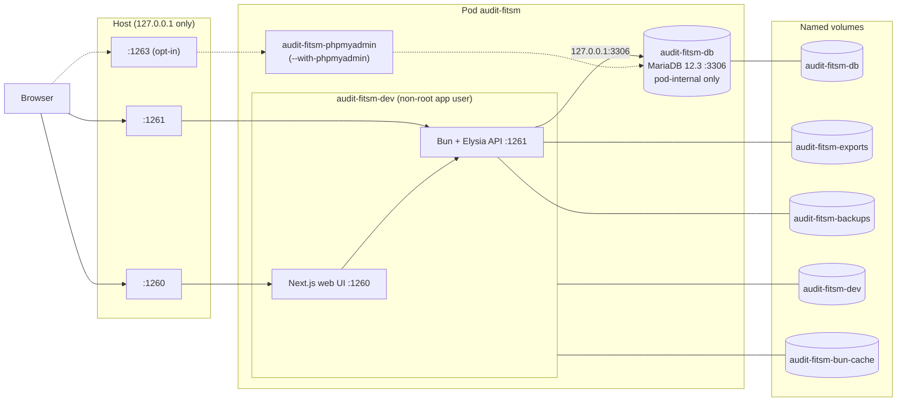

# Audit FitSM

[](LICENSE) [](https://github.com/UncleJS/audit_fitsm/actions/workflows/ci.yml) [](https://bun.sh) [](https://nextjs.org) [](https://elysiajs.com) [](https://mariadb.org) [](https://podman.io)

Audit FitSM is a tool for running efficient, structured and repeatable audits against the [FitSM](https://www.fitsm.eu/) service management framework.

## Table of Contents

- [Overview](#overview)
- [Highlights](#highlights)
- [Architecture](#architecture)
- [Ports](#ports)
- [Prerequisites](#prerequisites)
- [Project layout](#project-layout)
- [Documentation index](#documentation-index)
- [Quick start](#quick-start)
- [Lifecycle scripts](#lifecycle-scripts)
  - [Core lifecycle](#core-lifecycle)
  - [Uninstall and cleanup](#uninstall-and-cleanup)
  - [Database and data](#database-and-data)
  - [Diagnostics and checks](#diagnostics-and-checks)
  - [Package aliases](#package-aliases)
- [Upgrading an existing install](#upgrading-an-existing-install)
- [Daily workflow](#daily-workflow)
- [Audit workspace save behavior](#audit-workspace-save-behavior)
- [Development runtime model](#development-runtime-model)
- [Authentication and authorization](#authentication-and-authorization)
- [API and OpenAPI docs](#api-and-openapi-docs)
- [Health checks and testing](#health-checks-and-testing)
- [Time zones](#time-zones)
- [Operational notes](#operational-notes)
- [License](#license)

## Overview

FitSM is a lightweight, pragmatic service management framework for IT service management (ITSM). It suits small and medium-sized organizations or teams that want good practice without the overhead of heavier frameworks.

Audit FitSM gives auditors one place to manage audit criteria, capture evidence, track findings and produce reports. Auditors work through the FitSM requirements systematically, so assessments stay consistent and complete. Digitizing the workflow reduces manual effort and errors.

The tool ships the FitSM audit checklist, per-process scope and certification targets, and structured capability scoring. Auditors record observations, attach evidence references and write a conclusion. Reports (PDF and CSV) and trend views show the current maturity level, the gaps and the progress over time.

[↑ Back to TOC](#table-of-contents)

## Highlights

- client-scoped audit creation and management
- grouped FitSM process workspace with requirement scoring, evidence, notes and history
- audit details and conclusion capture
- autosave plus explicit manual save controls in the audit workspace
- PDF export generation and stored PDF download
- CSV exports for audit and trend reporting
- cookie-only browser sessions with CSRF header, rate limits and per-request role reload
- rootless Podman runtime managed with Quadlet units and `systemctl --user`
- OpenAPI JSON at `/openapi.json` and Swagger UI at `/docs`
- dark theme by default with a light toggle in the top nav (saved in `localStorage` key `audit-fitsm-theme`; tokens in `apps/web/app/globals.css`) and a shared license footer (`apps/web/app/components/layout/site-footer.tsx`)

[↑ Back to TOC](#table-of-contents)

## Architecture

Everything runs in one rootless Podman pod named `audit-fitsm`. The API and the web UI run in the same dev container, started by `scripts/dev-entrypoint.sh`. MariaDB is reachable only inside the pod.



[↑ Back to TOC](#table-of-contents)

## Ports

All published ports bind to `127.0.0.1` only.

| Service    | Host port | Notes |
|------------|-----------|-------|
| Web UI     | `1260`    | Next.js, always published |
| API        | `1261`    | Bun + Elysia, always published |
| phpMyAdmin | `1263`    | only when installed with `scripts/install.sh --with-phpmyadmin` |
| MariaDB    | none      | pod-internal `127.0.0.1:3306`, never published |

[↑ Back to TOC](#table-of-contents)

## Prerequisites

- Linux host with a `systemd --user` session (enable lingering with `loginctl enable-linger "$USER"` if services should outlive your login)
- rootless `podman` with Quadlet support
- `bash`, `git` and `systemctl`
- free host ports `1260` and `1261` (and `1263` when phpMyAdmin is enabled)

This project is Podman-only. Do not use Docker, rootful containers or `sudo`. Nothing is installed on the host; builds, dependency installs, migrations and tests all run in containers.

[↑ Back to TOC](#table-of-contents)

## Project layout

```text
apps/web/          Next.js web UI (pages in route groups app/(main)/ and app/(auth)/)
apps/api/          Bun + Elysia API, OpenAPI spec, DB scripts and integration suite
db/migrations/     SQL schema and reporting views
quadlet/           Quadlet units (.pod, .container, .build, .volume) and the opt-in phpMyAdmin drop-in
scripts/           lifecycle, data, diagnostics and CI scripts (shared names in scripts/common.sh)
docs/              operator, developer, API and workflow documentation
Containerfile      dev image (UBI 10 minimal + Bun, runs as non-root user app)
.env.example       reference of the environment variables the units set
```

[↑ Back to TOC](#table-of-contents)

## Documentation index

- [docs/README.md](docs/README.md) - documentation landing page
- [docs/audit-workspace.md](docs/audit-workspace.md) - audit workspace user guide
- [docs/development-runtime.md](docs/development-runtime.md) - container-first runtime and rebuild workflow
- [docs/api-surface.md](docs/api-surface.md) - route inventory, status codes and behavior notes
- [docs/security-model.md](docs/security-model.md) - sessions, CSRF, authorization, rate limits and secrets
- [docs/integration-testing.md](docs/integration-testing.md) - integration and readiness validation
- [docs/ci-runbook.md](docs/ci-runbook.md) - CI pipeline and troubleshooting
- [docs/ui-date-formatting.md](docs/ui-date-formatting.md) - date, timestamp and UTC policy
- [docs/ods-operational-mapping.md](docs/ods-operational-mapping.md) - FitSM workbook to database mapping
- [docs/documentation-style.md](docs/documentation-style.md) - Markdown rules for this repo
- [docs/style-audit-report.md](docs/style-audit-report.md) - documentation compliance checklist
- [docs/TEMPLATE.md](docs/TEMPLATE.md) - template used by `scripts/new-doc.sh`

[↑ Back to TOC](#table-of-contents)

## Quick start

1. Install: checks prerequisites, creates the Podman secrets, copies the Quadlet units to `~/.config/containers/systemd/`, reloads systemd and builds the image. `--start` starts the stack afterwards.

```bash
scripts/install.sh --start
# or, with phpMyAdmin on 127.0.0.1:1263:
scripts/install.sh --with-phpmyadmin --start
```

2. Apply migrations:

```bash
scripts/migrate.sh
```

3. Bootstrap the first admin. The password (at least 12 characters) comes from `BOOTSTRAP_ADMIN_PASSWORD` or an interactive prompt, never from the command line:

```bash
scripts/bootstrap-admin.sh admin@example.com "System Admin" "Default Organization"
```

4. Optional: import a filled-in FitSM workbook as an example audit. The full FitSM-6 catalog (processes, requirements, guidance) already ships as migration `0017_fitsm6_catalog_seed.sql`, so this is only needed for the example data. Download the workbook from [fitsm.eu](https://www.fitsm.eu/downloads/), place it at the repo root, then run:

```bash
scripts/import-fitsm.sh 1 1 "Initial Imported Audit"
```

5. Open:

- `http://127.0.0.1:1260/login`
- `http://127.0.0.1:1261/docs` (sign in through the web UI first)
- `http://127.0.0.1:1263/` (only with `--with-phpmyadmin`; log in with MariaDB credentials)

[↑ Back to TOC](#table-of-contents)

## Lifecycle scripts

All scripts live in `scripts/`, run from any directory, support `-h`/`--help`, and only call `podman` and `systemctl --user`. Shared names (pod, services, images, volumes, secrets, ports) live in `scripts/common.sh`. Everything the repo creates is named `audit-fitsm*` and labelled `io.audit-fitsm.project=audit-fitsm`.

[↑ Back to TOC](#table-of-contents)

### Core lifecycle

| Script | Does |
|--------|------|
| `install.sh [--with-phpmyadmin] [--start] [--no-build]` | Check rootless podman and the systemd user session, preflight the ports, create missing secrets, render/copy the units to `~/.config/containers/systemd/`, `daemon-reload`, build the image. Without `--with-phpmyadmin` a previously installed phpMyAdmin unit is removed. |
| `build.sh [--no-cache]` | Build or rebuild `localhost/audit-fitsm-dev:latest` (via `audit-fitsm-dev-build.service`, or `podman build` with `--no-cache`). |
| `start.sh` | `systemctl --user start` the pod, DB, dev (and phpMyAdmin if installed), then print the URLs. |
| `stop.sh` | Stop all services. Volumes are kept. |
| `restart.sh` | Run `stop.sh`, then `start.sh`. |
| `status.sh` | Show service, pod and container status. |
| `logs.sh [pod\|db\|dev\|api\|web\|pma\|build\|all] [--no-follow]` | Follow logs. `api` and `web` show the dev container output because both run there. |

[↑ Back to TOC](#table-of-contents)

### Uninstall and cleanup

`scripts/uninstall.sh [--purge] [--remove-quadlets]`

By default it stops the services, runs `systemctl --user reset-failed`, removes the containers (including CI containers), the pod and its infra container, the built images with their dangling layers, the pulled base images that no other container uses, the JWT secret and any legacy `.systemd/` user units. Skipped base images are reported (for example `mariadb:12.3` when another container still uses it).

It keeps, unless asked:

- the named volumes and the two DB password secrets (`--purge` removes them; MariaDB only reads the password when the volume is first initialized, so both go together)
- the Quadlet units in `~/.config/containers/systemd/` (`--remove-quadlets` removes them and runs `daemon-reload`)

`--purge-data` is a deprecated alias for `--purge`. `uninstall.sh --purge --remove-quadlets` leaves nothing of the project on the host. The script ends with a leftover check over containers, pods, images, volumes, networks, secrets and the unit directory, and exits non-zero if anything remains.

`scripts/clean-old-runtime.sh [--purge-data]` is a lighter reset: it removes pods, containers, CI volumes and built images but keeps the units and secrets.

[↑ Back to TOC](#table-of-contents)

### Database and data

| Script | Does |
|--------|------|
| `migrate.sh` | Apply the SQL migrations in `db/migrations/`. |
| `bootstrap-admin.sh [email] [display-name] [org-name]` | Create or update the first admin. Password from `BOOTSTRAP_ADMIN_PASSWORD` or a prompt, at least 12 characters. |
| `import-fitsm.sh [--file PATH] [org-id] [user-id] [audit-name] [audit-date]` | Import a FitSM workbook (`.xlsx` or `.ods`, default at the repo root) into a new audit. The file is copied into the dev container with `podman cp`. |
| `generate-fitsm-seed.sh [workbook-path]` | Regenerate `db/migrations/0017_fitsm6_catalog_seed.sql` from the official workbook (needs the dev container running). |
| `backup-db.sh` | Write a zip backup to the `audit-fitsm-backups` volume (`/workspace/data/backups`). |
| `list-backups.sh` | List the backups. |
| `restore-db.sh /workspace/data/backups/<file>.zip` | Restore a backup. It takes a pre-restore backup first and refuses a dump made for a different database name. The underlying `restore:db` script also accepts `--force` and `--skip-pre-backup`. |

[↑ Back to TOC](#table-of-contents)

### Diagnostics and checks

| Script | Does |
|--------|------|
| `health-readiness.sh [basic\|extended\|strict]` | Readiness checks inside the dev container (default `strict`). |
| `integration-test.sh` | Run the API integration suite inside the dev container. |
| `ci-strict.sh` | Container-first strict CI in a throwaway `audit-fitsm-ci` pod with random credentials; prints API/web/DB logs on failure. |
| `preflight-ports.sh [--allow-pod NAME] PORT...` | Fail if a host port is in use (ports of the named pod are allowed). |
| `ports.sh [PORT...]` | Show host listeners and Podman mappings (default `1260 1261 1263`). |
| `check-secrets.sh` | Fail on committed private keys or hard-coded secret values. |
| `check-ui-date-inputs.sh` | Enforce the date-input wrapper policy in the web UI. |
| `new-doc.sh <relative-path.md> <title>` | Create a compliant Markdown page from `docs/TEMPLATE.md`. |

`scripts/dev-entrypoint.sh` is the dev container entrypoint (starts API and web). `scripts/run-api.sh` and `scripts/run-web.sh` start an extra API or web process inside the running container for debugging.

[↑ Back to TOC](#table-of-contents)

### Package aliases

The root `package.json` maps the scripts to aliases such as `stack:install`, `stack:build`, `stack:start`, `stack:stop`, `stack:restart`, `stack:uninstall`, `db:migrate`, `backup:db` and `restore:db`. Run them inside a container; the scripts themselves are the host entry point.

[↑ Back to TOC](#table-of-contents)

## Upgrading an existing install

The layout changed: `.quadlet/` is now `quadlet/`, `scripts/_common.sh` is `scripts/common.sh`, `Containerfile.dev` is `Containerfile`, and the `.systemd/` API/web services are gone (`uninstall.sh` removes leftover copies). The DB port is no longer published, and phpMyAdmin is opt-in.

Credentials now come from random Podman secrets. A DB volume created by an older install was initialized with the password `change_me`, which no longer matches. Choose one:

- Back up with `scripts/backup-db.sh`, then run `scripts/uninstall.sh --purge` (destroys all data) and `scripts/install.sh --start`, then migrate and restore.
- Keep the data: set the secret to the old value before starting, with `podman secret rm audit-fitsm-db-password` followed by `printf '%s' 'change_me' | podman secret create audit-fitsm-db-password -`, then change the DB password properly later.

[↑ Back to TOC](#table-of-contents)

## Daily workflow

1. Sign in at `/login`.
2. Use `/admin` to create a client and manage org-scoped users and roles.
3. Use `/clients` to select a client and register a new audit.
4. Open `/audits/:auditId` for the full audit workspace.
5. Score requirements, add comments and evidence, capture audit details and write the conclusion.
6. Generate CSV and PDF outputs when the audit content is ready.

[↑ Back to TOC](#table-of-contents)

## Audit workspace save behavior

The audit workspace supports autosave and explicit save actions.

- Autosave runs after a short pause while editing, and when a field loses focus.
- A manual save block sits near the top of the page, and a sticky save panel stays available while scrolling.
- Manual actions: `Save scope & targets`, `Save assessments`, `Save details`, `Save conclusion`, `Save all`, `Save status` (manual only).
- Scope and certification targets are editable only while the status is `draft`. Non-lead users cannot edit a `completed` audit. Conclusion and `Save all` need lead auditor or org admin rights.

See [docs/audit-workspace.md](docs/audit-workspace.md) for the full guide.

[↑ Back to TOC](#table-of-contents)

## Development runtime model

There are no bind mounts. The `Containerfile` copies the repository into `/workspace` at build time, and data lives in named volumes. After changing source files, rebuild and restart:

```bash
scripts/build.sh
scripts/restart.sh
```

Useful checks:

```bash
scripts/status.sh
scripts/logs.sh dev
```

See [docs/development-runtime.md](docs/development-runtime.md) for the full workflow.

[↑ Back to TOC](#table-of-contents)

## Authentication and authorization

- The browser session is a cookie only (`HttpOnly`, `SameSite=Strict`, `Secure` in production and staging) carrying a signed JWT. Bearer tokens are not accepted, and login returns `{ ok: true, expiresInSec }` with no token in the body.
- The web UI calls `POST /auth/refresh` about every 5 minutes while the user is active. `POST /auth/logout` ends all of that user's sessions everywhere.
- Every non-GET/HEAD/OPTIONS request, including login and logout, must send `x-audit-fitsm: 1`, otherwise the API answers `403`.
- Roles are loaded from the database on each request; role and password changes revoke existing sessions.
- Non-system-admin users are scoped to a single client (org). An org admin cannot reset or demote a system admin.

See [docs/security-model.md](docs/security-model.md).

[↑ Back to TOC](#table-of-contents)

## API and OpenAPI docs

- API base URL: `http://127.0.0.1:1261`
- Swagger UI: `http://127.0.0.1:1261/docs`
- OpenAPI JSON: `http://127.0.0.1:1261/openapi.json` (source: `apps/api/openapi/openapi.json`)

Outside `NODE_ENV=development`/`test`, both docs routes need a valid session. See [docs/api-surface.md](docs/api-surface.md) for the route inventory.

[↑ Back to TOC](#table-of-contents)

## Health checks and testing

```bash
scripts/health-readiness.sh basic
scripts/health-readiness.sh extended
scripts/health-readiness.sh strict   # includes the integration suite
scripts/integration-test.sh
```

CI (`.github/workflows/ci.yml`) runs lint, typecheck, unit tests, secret scan, the UI date-input check and ShellCheck, then the Podman integration job through `scripts/ci-strict.sh`. See [docs/integration-testing.md](docs/integration-testing.md) and [docs/ci-runbook.md](docs/ci-runbook.md).

[↑ Back to TOC](#table-of-contents)

## Time zones

- MariaDB runs with `--default-time-zone=+00:00` and `TZ=UTC`; the API pool uses time zone `Z` and sets `time_zone` on every connection.
- The API sends and receives timestamps as ISO 8601 UTC (`2026-11-20T14:05:09Z`).
- The web UI shows local time as `yyyy-MM-dd HH:mm:ss` and dates as `yyyy-MM-dd`.
- Every date/time column uses the `*_UTC` suffix (`created_UTC`, `updated_UTC`, `archived_UTC`, `audit_date_UTC`, …); migration `0016_utc_column_names.sql` renamed the older `*_at` columns. API JSON keys use the same names.

See [docs/ui-date-formatting.md](docs/ui-date-formatting.md).

[↑ Back to TOC](#table-of-contents)

## Operational notes

- archive-only data lifecycle; audit data is not hard-deleted
- PDFs are stored under `/workspace/data/exports` (volume `audit-fitsm-exports`)
- backups are stored under `/workspace/data/backups` (volume `audit-fitsm-backups`)
- reporting views: `v_all_results`, `v_certification_results`, `v_gap_analysis`, `v_trends`
- secrets: `audit-fitsm-db-password`, `audit-fitsm-db-root-password`, `audit-fitsm-jwt-secret` (random, created by `install.sh`)
- images: `docker.io/library/mariadb:12.3`, `docker.io/library/phpmyadmin:5.2.3` (opt-in), `docker.io/oven/bun:1.2.22`, `registry.access.redhat.com/ubi10/ubi-minimal:10.3-1795196920`

[↑ Back to TOC](#table-of-contents)

## License

Copyright (C) 2026 UncleJS. This program is free software: you can redistribute it and/or modify it under the terms of the GNU Affero General Public License as published by the Free Software Foundation, either version 3 of the License, or (at your option) any later version.

This program is distributed in the hope that it will be useful, but WITHOUT ANY WARRANTY; without even the implied warranty of MERCHANTABILITY or FITNESS FOR A PARTICULAR PURPOSE. See the [LICENSE](LICENSE) file for the full text.

FitSM content: `db/migrations/0017_fitsm6_catalog_seed.sql` reproduces, verbatim and unmodified, the process names, requirements and guidance of "FitSM-6: Capability / Maturity Assessment Scheme" (Assessment and Audit Tool, Version 3.0.3) by the FitSM working group / FitSM e.V. ([fitsm.eu](https://www.fitsm.eu/)). That content is licensed under [CC BY-ND 4.0](https://creativecommons.org/licenses/by-nd/4.0/), not the AGPL. FitSM was co-funded by the European Commission under contract number 312851. FitSM and the FitSM logo are trademarks registered by FitSM e.V. on behalf of the FitSM Committee; their use here does not signify any affiliation with or endorsement by the FitSM Committee or FitSM e.V. See [NOTICE](NOTICE).

[↑ Back to TOC](#table-of-contents)

---

© 2026 UncleJS — Licensed under [AGPL-3.0-or-later](https://www.gnu.org/licenses/agpl-3.0.txt)
