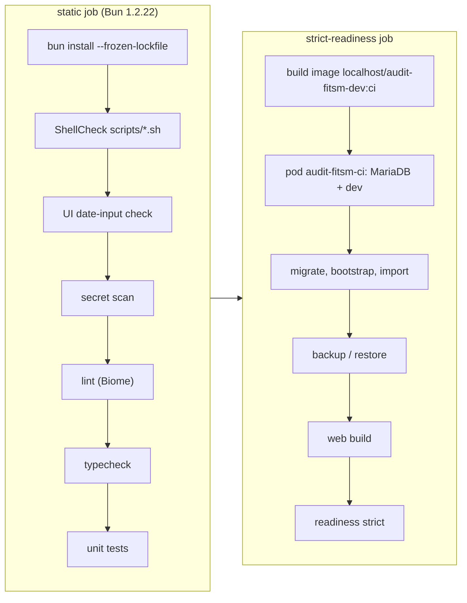

# CI Runbook

[](../LICENSE) [](https://github.com/UncleJS/audit_fitsm/actions/workflows/ci.yml) [](https://bun.sh) [](https://podman.io)

Pipeline overview and troubleshooting for `.github/workflows/ci.yml` and `scripts/ci-strict.sh`.

## Table of Contents

- [Scope](#scope)
- [Pipeline](#pipeline)
- [Fast triage](#fast-triage)
- [Common failures and fixes](#common-failures-and-fixes)
  - [Static checks failure](#static-checks-failure)
  - [Date-input policy failure](#date-input-policy-failure)
  - [Image build failure](#image-build-failure)
  - [Port preflight failure](#port-preflight-failure)
  - [DB readiness timeout](#db-readiness-timeout)
  - [API health or ready failing](#api-health-or-ready-failing)
  - [Web check timeout](#web-check-timeout)
  - [Docs route failure](#docs-route-failure)
  - [Strict integration-suite failure](#strict-integration-suite-failure)
- [Collect diagnostics](#collect-diagnostics)
- [Re-run strategy](#re-run-strategy)

## Scope

This runbook covers the static job and the strict Podman job. Primary files:

- `.github/workflows/ci.yml`
- `scripts/ci-strict.sh`
- `scripts/health-readiness.sh` and `apps/api/scripts/health-readiness.ts`
- `scripts/check-secrets.sh`, `scripts/check-ui-date-inputs.sh`

[↑ Back to TOC](#table-of-contents)

## Pipeline

The workflow runs on pull requests and on pushes to `main`, `master` or `development`. It has `permissions: contents: read`, and every action is pinned to a commit SHA.



`scripts/ci-strict.sh` generates random DB, JWT and admin credentials per run as `audit-fitsm-ci-*` Podman secrets, and removes the pod, containers, volumes and secrets afterwards unless `KEEP_CONTAINERS=1`.

[↑ Back to TOC](#table-of-contents)

## Fast triage

1. Open the failing job and find the first failed step.
2. For the strict job, scroll to the end of the log: on failure the script prints `podman logs --tail 200` of the dev container (API and web) and the DB container.
3. Match the failure to a class below, fix it and re-run.

[↑ Back to TOC](#table-of-contents)

## Common failures and fixes

Each entry lists the symptom, typical causes and the fix.

[↑ Back to TOC](#table-of-contents)

### Static checks failure

- Symptom: ShellCheck, lint, typecheck, unit tests or the secret scan fail in the static job.
- Fix: run the same command in a Bun container (for example `bun run lint` inside `docker.io/oven/bun:1.2.22`), never on the host. For the secret scan, replace the literal with a Podman secret or a `<placeholder>`.

[↑ Back to TOC](#table-of-contents)

### Date-input policy failure

- Symptom: `scripts/check-ui-date-inputs.sh` fails.
- Cause: a raw `type="date"` input outside the wrapper component.
- Fix: use `apps/web/app/components/date-only-input.tsx`, then re-run the script.

[↑ Back to TOC](#table-of-contents)

### Image build failure

- Symptom: the job fails while building the image.
- Causes: a transient registry or network issue, or a broken `Containerfile` change.
- Fix: re-run once; if it persists, reproduce with `scripts/build.sh --no-cache`.

[↑ Back to TOC](#table-of-contents)

### Port preflight failure

- Symptom: the script stops before the build with a host-port conflict.
- Cause: something already listens on `1260` or `1261`.
- Fix: stop the conflicting service (for a local run usually `scripts/stop.sh`), inspect with `scripts/ports.sh 1260 1261`, or use other ports:

```bash
APP_PORT=2261 WEB_PORT=2260 bash ./scripts/ci-strict.sh
```

[↑ Back to TOC](#table-of-contents)

### DB readiness timeout

- Symptom: failure in the MariaDB wait loop.
- Causes: slow startup under runner load, or a DB init error (see the DB log printed at the end).
- Fix: read the DB log; increase the wait only if the timeout repeats under load.

[↑ Back to TOC](#table-of-contents)

### API health or ready failing

- Symptom: the readiness script fails at `/health` or `/ready`.
- Causes: the API process did not start, or migrations did not run.
- Fix: read the dev container log printed at the end of the job; confirm the migrate step completed.

[↑ Back to TOC](#table-of-contents)

### Web check timeout

- Symptom: readiness fails at the web HTTP check.
- Causes: slow Next.js warm-up or a web startup error.
- Fix: read the dev container log; if needed, tune the attempt count in `apps/api/scripts/health-readiness.ts`.

[↑ Back to TOC](#table-of-contents)

### Docs route failure

- Symptom: checks fail on `/docs` or `/openapi.json`.
- Causes: missing `apps/api/openapi/openapi.json` in the image, a CSP regression, or a request without a session (both routes need one outside `development`/`test`).
- Fix: read the API output in the dev container log and reproduce with the integration suite.

[↑ Back to TOC](#table-of-contents)

### Strict integration-suite failure

- Symptom: basic checks pass but the integration suite fails.
- Causes: an API contract or auth/role regression.
- Fix: find the failing endpoint in the output. Without the workbook at `FITSM_ODS_PATH`, CI falls back to the minimal seeded FitSM catalog. Reproduce while the CI pod is kept:

```bash
KEEP_CONTAINERS=1 bash ./scripts/ci-strict.sh
podman exec audit-fitsm-dev-ci bun run --cwd /workspace/apps/api integration:test
```

[↑ Back to TOC](#table-of-contents)

## Collect diagnostics

Run the same pipeline locally (Podman only):

```bash
bash ./scripts/ci-strict.sh
```

On failure it prints the dev (API + web) and DB container logs. Also note the failing command and exit code. With `KEEP_CONTAINERS=1` the pod stays up for `podman logs audit-fitsm-dev-ci` and `podman logs audit-fitsm-db-ci`; `scripts/uninstall.sh` cleans up CI leftovers too.

[↑ Back to TOC](#table-of-contents)

## Re-run strategy

- Re-run once for transient network or build failures.
- If the failure repeats, fix it on the branch and re-run the full workflow.
- Change one variable at a time (build, DB readiness, API readiness, integration behavior) to keep the root cause clear.

[↑ Back to TOC](#table-of-contents)

---

© 2026 UncleJS — Licensed under [AGPL-3.0-or-later](https://www.gnu.org/licenses/agpl-3.0.txt)
