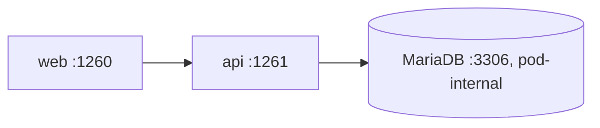

# Documentation Style

[](../LICENSE) [](https://github.com/UncleJS/audit_fitsm/actions/workflows/ci.yml) [](https://mermaid.js.org)

Rules for every Markdown page in this repository (the root `README.md` and `docs/*.md`, including `docs/TEMPLATE.md`).

## Table of Contents

- [Overview](#overview)
- [Page structure](#page-structure)
  - [Badges](#badges)
  - [Table of contents and back links](#table-of-contents-and-back-links)
  - [Footer](#footer)
- [Content rules](#content-rules)
  - [Writing and formatting](#writing-and-formatting)
  - [Diagrams](#diagrams)
  - [Dates and times](#dates-and-times)
  - [Links and paths](#links-and-paths)
- [Exemptions](#exemptions)
- [New pages](#new-pages)
- [Pre-merge checklist](#pre-merge-checklist)

## Overview

Every page has the same frame: an H1 title, a badge row, a table of contents, sections that each end with a back link, and the license footer. The project is licensed under AGPL-3.0-or-later (copyright UncleJS, 2026); see [LICENSE](../LICENSE).

[↑ Back to TOC](#table-of-contents)

## Page structure

Order on every page: `# Title`, badge row, a short purpose sentence, `## Table of Contents`, content sections, `---`, footer.

[↑ Back to TOC](#table-of-contents)

### Badges

- Put one row of [shields.io](https://shields.io) badges directly under the H1.
- Use only badges that are true for the repo, and link each to its source (license file, CI workflow, project site).
- The license badge is required. In `docs/` the link is `../LICENSE`; at the repo root it is `LICENSE`:

```markdown
[](../LICENSE)
```

- The repo is public, so the CI badge is allowed and links to the workflow:

```markdown
[](https://github.com/UncleJS/audit_fitsm/actions/workflows/ci.yml)
```

- If the repo ever goes private, remove every CI badge (GitHub returns 404 to anonymous visitors).

[↑ Back to TOC](#table-of-contents)

### Table of contents and back links

- `## Table of Contents` links every `##` heading, with `###` headings nested under their parent. Do not list the H1 or the TOC itself.
- Use GitHub anchors: lowercase, spaces become `-`, punctuation other than `-` and `_` is dropped. `Scope & Targets` becomes `#scope--targets`; `Clients (organizations)` becomes `#clients-organizations`.
- Every section listed in the TOC ends with its own line:

```markdown
[↑ Back to TOC](#table-of-contents)
```

- A `##` with `###` children gets a back link at the end of each `###`, and at the end of its intro text if it has any before the first `###`.
- Pages with fewer than three sections get no TOC and no back links (they still get badges and the footer).
- Update the TOC, anchors and back links whenever headings change.

[↑ Back to TOC](#table-of-contents)

### Footer

The footer is the last thing on the page: after the final back link, a `---` rule, then:

```markdown
© 2026 UncleJS — Licensed under [AGPL-3.0-or-later](https://www.gnu.org/licenses/agpl-3.0.txt)
```

There is no separate "License footer" section and no TOC entry for it. In later years the year becomes a range, for example `2026-2027`.

[↑ Back to TOC](#table-of-contents)

## Content rules

These apply to the body of every page.

[↑ Back to TOC](#table-of-contents)

### Writing and formatting

- Use sentence case headings.
- Prefer short paragraphs and bullet lists; keep language direct and operational.
- Use code fences for commands, config and output, and backticks for paths, env vars and endpoints.
- Use active voice and imperative instructions in runbooks.
- Show only rootless Podman and Quadlet commands; never Docker, `sudo` or host package installs.
- Never put real secrets or credentials in examples; use `<placeholders>`.

[↑ Back to TOC](#table-of-contents)

### Diagrams

Every diagram is a fenced `mermaid` block; never ASCII or box-drawing art. Pick the fitting type (`flowchart`, `sequenceDiagram`, `stateDiagram-v2`, `erDiagram`, `classDiagram`, `gantt`, `timeline`). When you touch a page that has an ASCII diagram, convert it.

````markdown

````

Plain code blocks stay for code, commands, config and tool output such as a `tree` listing.

[↑ Back to TOC](#table-of-contents)

### Dates and times

- Dates as `yyyy-MM-dd` (`2026-11-20`), times as `yyyy-MM-dd HH:mm:ss`, 24-hour (`2026-11-20 14:05:09`). No month names like "November 2026", no AM/PM, no locale formats.
- Machine-readable values use full ISO 8601 UTC (`2026-11-20T14:05:09Z`).
- See [ui-date-formatting.md](ui-date-formatting.md) for the application rules.

[↑ Back to TOC](#table-of-contents)

### Links and paths

- Prefer relative links inside the repo.
- Use stable canonical URLs for external links.
- Write file paths repo-root relative where possible.

[↑ Back to TOC](#table-of-contents)

## Exemptions

These files keep the format their tool or convention needs and get no badges, TOC, back links or footer:

- `AGENTS.md`, `CLAUDE.md`, `MEMORY.md` and other agent or memory files
- generated files (for example a tool-generated `CHANGELOG.md`)
- templates under `.github/`
- the `LICENSE` file (the unmodified AGPL v3 text)

[↑ Back to TOC](#table-of-contents)

## New pages

Create pages with the generator, which copies `docs/TEMPLATE.md`, fills in the title and fixes the license link depth:

```bash
scripts/new-doc.sh docs/backup-runbook.md "Backup Runbook"
```

Then rename the placeholder sections, keep the TOC in sync and add the page to [docs/README.md](README.md) and the root README documentation index.

[↑ Back to TOC](#table-of-contents)

## Pre-merge checklist

- [ ] H1 followed by a true, linked badge row including the AGPL license badge
- [ ] `## Table of Contents` lists every `##` and nested `###`, anchors resolve
- [ ] every listed section ends with `[↑ Back to TOC](#table-of-contents)`
- [ ] `---` and the AGPL footer are the last lines
- [ ] diagrams are Mermaid only
- [ ] dates are `yyyy-MM-dd`, times `yyyy-MM-dd HH:mm:ss`
- [ ] commands tested or marked example-only, Podman-only
- [ ] no secrets or credential values

[↑ Back to TOC](#table-of-contents)

---

© 2026 UncleJS — Licensed under [AGPL-3.0-or-later](https://www.gnu.org/licenses/agpl-3.0.txt)
