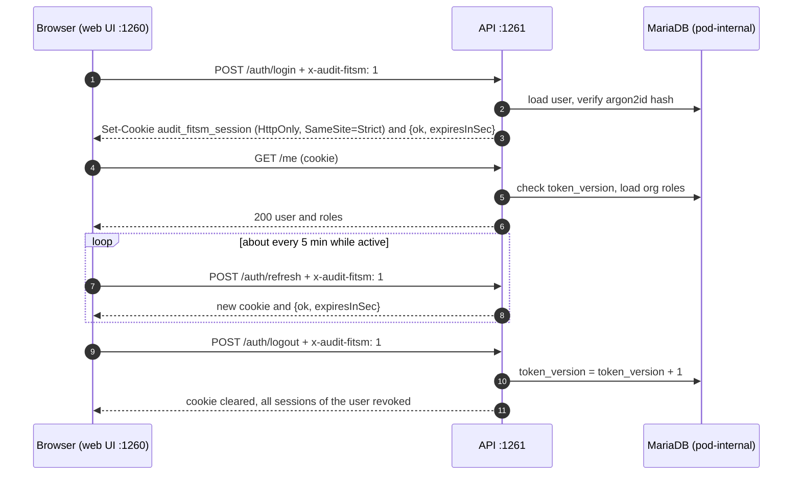

# Security Model

  

How Audit FitSM authenticates browsers, protects writes, authorizes org roles, limits abuse and handles secrets. Source: `apps/api/src/app-base.ts`, `apps/api/src/routes/auth.ts`, `apps/api/src/session-cookie.ts`, `apps/api/src/rate-limit.ts`, `apps/api/src/config.ts`.

## Table of Contents

- [Sessions](#sessions)
  - [Login](#login)
  - [Refresh and expiry](#refresh-and-expiry)
  - [Logout](#logout)
  - [Request flow](#request-flow)
- [CSRF protection](#csrf-protection)
- [Authorization](#authorization)
- [Rate limits](#rate-limits)
- [Validation and errors](#validation-and-errors)
- [API docs access](#api-docs-access)
- [Files and exports](#files-and-exports)
- [Network exposure](#network-exposure)
- [Secrets](#secrets)

## Sessions

Browser sessions are cookie-only. The cookie `audit_fitsm_session` carries a signed JWT and is set with `HttpOnly`, `SameSite=Strict`, `Path=/` and, in production and staging, `Secure`. The web UI never sees or stores the token; it calls the API with `credentials: "include"`. `Authorization: Bearer` headers are not accepted.

[↑ Back to TOC](#table-of-contents)

### Login

`POST /auth/login` verifies the password with argon2id and sets the cookie. The response body is `{ "ok": true, "expiresInSec": <n> }`; no token is returned. The lifetime comes from `JWT_TTL_SEC` (default `900`, minimum `60`).

[↑ Back to TOC](#table-of-contents)

### Refresh and expiry

`POST /auth/refresh` re-issues the cookie for a valid session and returns the same `{ ok, expiresInSec }` shape. The web UI (`apps/web/app/lib/use-session-keepalive.ts`) calls it about every 5 minutes while the tab is visible and the user is active, so idle sessions expire on their own.

[↑ Back to TOC](#table-of-contents)

### Logout

`POST /auth/logout` clears the cookie and increments the user's `token_version`. That ends every session of that user everywhere (other tabs, other devices, copied cookies). The `/logout` page calls it before returning to `/login`.

[↑ Back to TOC](#table-of-contents)

### Request flow

[↑ Back to TOC](#table-of-contents)

## CSRF protection

Every request that is not `GET`, `HEAD` or `OPTIONS` must carry the header `x-audit-fitsm: 1`, including login, refresh and logout. Requests without it get `403`. A cross-site form or image cannot set a custom header, and `SameSite=Strict` keeps the cookie off cross-site requests. CORS allows only the origins in `CORS_ALLOWED_ORIGINS` (default `http://127.0.0.1:1260,http://localhost:1260`).

[↑ Back to TOC](#table-of-contents)

## Authorization

Each request checks the JWT's token version against `users.token_version`, then loads the org roles from `org_user_roles`, so a stale token cannot keep an old role list. Role changes, password resets and logout increment the token version.

- Non-system-admin users belong to one client (org); cross-client assignment returns `409`.
- The `system_admin` role cannot be assigned through org endpoints, and an org admin cannot reset or demote a system admin.
- Completed audits are read-only for roles below lead auditor.

[↑ Back to TOC](#table-of-contents)

## Rate limits

- Global, per `RATE_LIMIT_WINDOW_MS` (default `60000`), applied to every route:
  - per client IP, method and normalized route: `RATE_LIMIT_MAX` requests (default `300`);
  - per client IP across all routes: `RATE_LIMIT_IP_MAX` requests (default `1200`).
- Login, per `LOGIN_RATE_LIMIT_WINDOW_MS` (default 15 minutes):
  - per client IP: `LOGIN_RATE_LIMIT_IP_MAX` attempts (default `30`), counting every attempt;
  - per email address and client IP: `LOGIN_RATE_LIMIT_MAX` failed attempts (default `10`);
  - per email address across all IPs: `LOGIN_RATE_LIMIT_EMAIL_GLOBAL_MAX` failed attempts (default `100`), as a brute-force backstop.
  - Emails are trimmed and lowercased for these keys. A successful login clears the email-and-IP bucket and does not count against the global email cap, so failing against someone else's email from one address cannot lock that user out from other addresses.
- Exceeding a limit returns `429`.
- `X-Forwarded-For` is used only when `TRUST_PROXY=1`, and then only its rightmost hop (the one the trusted proxy added).

[↑ Back to TOC](#table-of-contents)

## Validation and errors

Request bodies are validated with zod. Invalid payloads return `400`, duplicate keys and races return `409`, and any unhandled error returns a generic `500 {"error":"Internal server error"}`. Details are logged server-side (in UTC) and never sent to the client.

[↑ Back to TOC](#table-of-contents)

## API docs access

`/docs` and `/openapi.json` are public only when `NODE_ENV` is `development` or `test`. Otherwise (including the local Quadlet runtime, which does not set `NODE_ENV`) they need a valid session: sign in through the web UI at `http://127.0.0.1:1260` first.

[↑ Back to TOC](#table-of-contents)

## Files and exports

PDF downloads resolve `file_path` under `EXPORTS_DIR` and reject `..`. CSV cells that look like spreadsheet formulas are prefixed with a quote.

[↑ Back to TOC](#table-of-contents)

## Network exposure

Only the web (`127.0.0.1:1260`) and API (`127.0.0.1:1261`) ports are published, on loopback. phpMyAdmin (`127.0.0.1:1263`) is published only when installed with `scripts/install.sh --with-phpmyadmin`, and has no stored credentials. MariaDB is never published; containers in the pod reach it on `127.0.0.1:3306`.

[↑ Back to TOC](#table-of-contents)

## Secrets

`scripts/install.sh` creates these Podman secrets with random values if they are missing; the Quadlet units inject them as environment variables:

| Secret | Injected as |
|--------|-------------|
| `audit-fitsm-db-password` | `MARIADB_PASSWORD` (db), `DB_PASSWORD` (dev) |
| `audit-fitsm-db-root-password` | `MARIADB_ROOT_PASSWORD` (db) |
| `audit-fitsm-jwt-secret` | `JWT_SECRET` (dev) |

The API refuses to start without `JWT_SECRET` and `DB_PASSWORD`, and rejects the old placeholder values. CI (`scripts/ci-strict.sh`) creates its own random `audit-fitsm-ci-*` secrets per run. `scripts/check-secrets.sh` fails the build on committed keys or hard-coded secret values. `.env.example` documents the variables only and holds no secrets.

[↑ Back to TOC](#table-of-contents)

---

© 2026 UncleJS — Licensed under [AGPL-3.0-or-later](https://www.gnu.org/licenses/agpl-3.0.txt)
